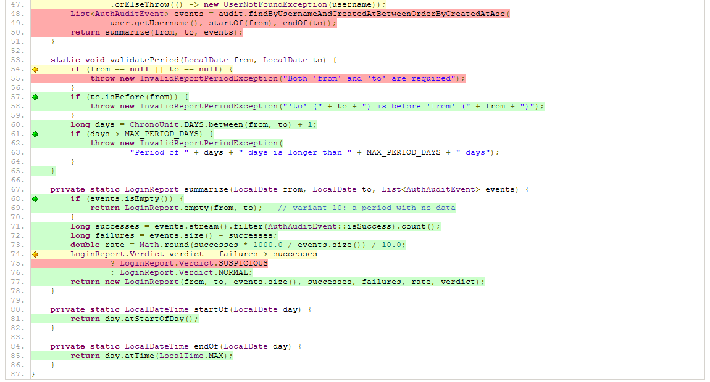
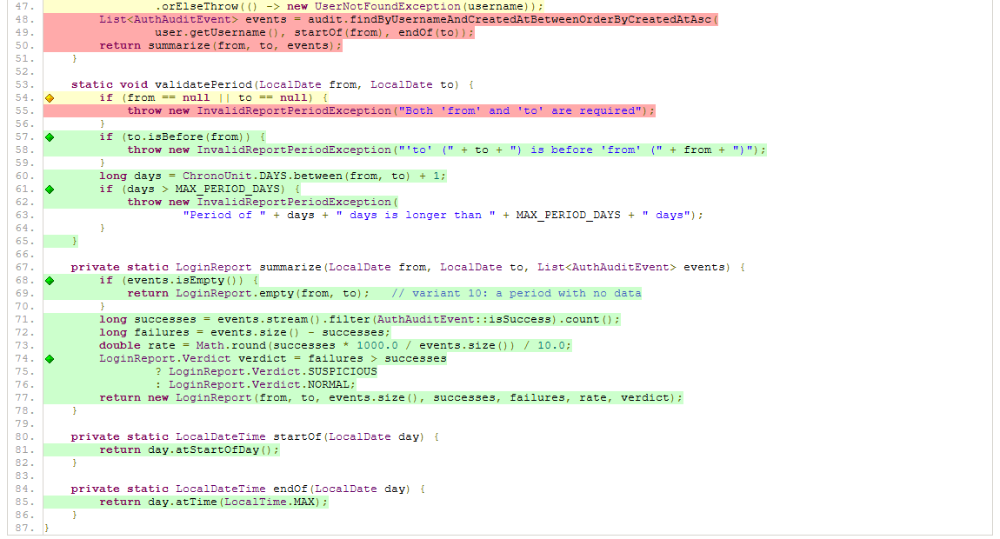

# Laboratory work 12 — evidence

**Student:** Akhmetkali Margulan · **Group:** 2501 · **Variant:** 10 (`ReportService`)
**Branch:** [`lab09`](https://github.com/Marghoul/spring-lab-01/tree/lab09) (named lab09 in this repository; created from `lab08`)
**Stack actually used:** Spring Boot 4.1.1 · Java 25 · JUnit 5 · Mockito · AssertJ · Testcontainers 2.0.5 · JaCoCo 0.8.16 · Maven · H2 for the application and the slice tests (see task 4: Docker was not available)

| Variant 10 | |
|---|---|
| Class under unit test | `kz.iitu.spring_lab_01.report.ReportService` — login-activity report for a period, built from the `auth_audit` table of lab 10 |
| Branch that must be covered | a report for a period with no data → `LoginReport.Verdict.NO_DATA`, zero counters, success rate `0.0` (not `NaN`) |
| Extra requirement | `@CsvSource` covering the boundary values of the period (1 day, end before start, 365, 366 = `MAX_PERIOD_DAYS`, 367) |
| Package reported | `kz.iitu.spring_lab_01.report` |

## 1. `./mvnw clean verify`

```
[WARNING] Tests run: 2, Failures: 0, Errors: 0, Skipped: 2, Time elapsed: 0 s -- in kz.iitu.spring_lab_01.web.BookApiIntegrationTest
[INFO] Tests run: 44, Failures: 0, Errors: 0, Skipped: 2
[INFO] Loading execution data file C:\spring-lab-01\target\jacoco.exec
[INFO] Analyzed bundle '' with 34 classes
[INFO] BUILD SUCCESS
```

The 2 skipped tests are the Testcontainers class: `disabledWithoutDocker is true and Docker is not available` (task 4).

| Level | Class | Tests | Spring context |
|---|---|---|---|
| Unit (task 1) | `report/ReportServiceTest` | 5 + 5 parameterized cases | none — `@ExtendWith(MockitoExtension.class)` |
| Web slice (task 2) | `web/BookControllerTest` | 5 | `@WebMvcTest(BookController.class)` + real `SecurityConfiguration` |
| Data slice (task 3) | `security/AuthAuditRepositoryTest` | 3 | `@DataJpaTest` (embedded H2 + Flyway V1–V7) |
| Integration (task 4) | `web/BookApiIntegrationTest` | 2 (skipped, no Docker) | `@SpringBootTest(RANDOM_PORT)` + PostgreSQL 17 container |

## 2. Task 1 — unit tests of `ReportService`

| Test | What it proves |
|---|---|
| `reportCountsSuccessesAndFailuresOfThePeriod` | happy path: 3 successes + 1 failure → total 4, rate 75.0, `NORMAL` |
| `reportForAnUnknownUserIsRejectedWithoutReadingTheAudit` | not-found path: `findByUsername` → `Optional.empty()` → `UserNotFoundException`, and `verifyNoInteractions(audit)` |
| `periodIsTranslatedIntoInclusiveStartAndEndTimestamps` | `verify` + two `ArgumentCaptor`s: the repository receives `2026-11-01T00:00` and `2026-11-30T23:59:59.999999999` — the whole last day is included |
| `periodWithNoDataGivesAnEmptyReportInsteadOfDividingByZero` | **variant branch**: empty list → `NO_DATA`, zeros, rate `0.0` and not `NaN` |
| `periodLengthIsCheckedAtItsBoundaries` (`@CsvSource`, 5 rows) | **variant extra**: 1 day ✔, end before start ✘, 365 ✔, 366 ✔, 367 ✘ |
| `moreFailuresThanSuccessesMarksThePeriodAsSuspicious` | the test added in task 5 |

## 3. Task 2 — web slice: how the security chain was handled

`@WebMvcTest` does not scan `@Configuration` classes, so the real `SecurityConfiguration` is **imported** and every test that should succeed runs with **`@WithMockUser`** (`USER` for reads, `ADMIN` for the POST). Security is therefore exercised, not switched off: two extra tests check that an anonymous caller gets **401** and a `USER` gets **403** on POST. Excluding the security auto-configuration would make the slice prove less — it would no longer show that `/api/books/**` requires a role.

Results: `GET /api/books/1` → 200 with `$.title == "Dune"`; `GET /api/books/7` → 404 `application/problem+json` with `$.detail == "Book 7 not found"` (from `ApiExceptionHandler`, a `@RestControllerAdvice`); `POST /api/books` with `{"title":"","genre":null,"year":1200}` → 400 problem detail, `verifyNoInteractions(service)` — Bean Validation (`@Valid` + `CreateBookRequest`) stopped the request before the service.

Since this lab the API has its own stateless filter chain (`/api/**`, HTTP Basic, `@Order(1)`). The browser pages keep the lab 10 chain with form login and CSRF tokens.

## 4. Task 3 — data slice

`AuthAuditRepositoryTest` persists five rows with `TestEntityManager` (one second before the period, the first instant, the middle, the last second, the first instant after), then `em.flush()` and `em.clear()`.

* positive: `findByCreatedAtBetweenOrderByCreatedAtAsc` returns exactly the 3 rows inside November, in order;
* negative: `findByUsernameAndCreatedAtBetween…("user", …)` excludes `admin`'s row and the rows just outside the period;
* empty period → empty list (the case the service turns into `NO_DATA`).

> **H2 is used here**, said out loud: `@DataJpaTest` replaces the datasource with an embedded H2 database, on which Flyway runs V1–V7. This is a slice test, not the integration test.

**Demonstration item 8 — `em.flush()` removed (tried before the defence):** the tests still passed. The entity uses `GenerationType.IDENTITY`, so Hibernate must execute the `INSERT` at `persist()` time to learn the id — the log shows `insert into auth_audit … values (…, default)` immediately. With a sequence or a UUID generator the inserts would be delayed until flush; then `em.clear()` would discard the pending entities and the query would return an empty list. Removing `em.clear()` instead keeps the entities in the persistence context; the JPQL query still goes to the database (AUTO flush), but the returned objects would be the same instances that were persisted, so a wrong column mapping could be hidden.

## 5. Task 4 — Testcontainers: Docker not available

`BookApiIntegrationTest` is written (PostgreSQL 17 container, `@ServiceConnection`, `RestTestClient` with HTTP Basic: create as `admin` → 201, read back as `user` → 200; `user` POST → 403; anonymous → 401).

Command and error:

```
$ docker info
bash: docker: command not found

$ ./mvnw clean verify
o.t.d.DockerClientProviderStrategy : Could not find a valid Docker environment. Please check configuration. Attempted configurations were:
As no valid configuration was found, execution cannot continue.
See https://java.testcontainers.org/on_failure.html for more details.
[WARNING] Tests run: 2, Failures: 0, Errors: 0, Skipped: 2 -- in kz.iitu.spring_lab_01.web.BookApiIntegrationTest
<skipped message="disabledWithoutDocker is true and Docker is not available"/>
```

Docker Desktop is not installed on this workstation. `@Testcontainers(disabledWithoutDocker = true)` makes the class *skipped*, not green — it has **not** passed, and H2 is not substituted for it.

**What the container test would have proved that `@DataJpaTest` does not:**

1. The Flyway migrations V1–V7 run on **PostgreSQL** — `bigserial`, `generated by default as identity`, `boolean`, `decimal(19,2)`, `timestamp` — and `ddl-auto=validate` accepts the PostgreSQL column types. H2 accepts SQL that PostgreSQL may reject and vice versa.
2. The whole application starts on a real port: every bean, the two security filter chains, Jackson, the `@RestControllerAdvice` and the transaction boundaries work together, with real HTTP and real authentication against the BCrypt hashes stored in the database — the slices replace the service or the web layer with mocks.
3. Behaviour that depends on the engine (timestamp precision of the period boundaries, case sensitivity, locking) is observed on the engine that production uses.

Dependencies: Spring Boot 4.1 manages **Testcontainers 2.x**, where the modules are `org.testcontainers:testcontainers-postgresql` and `testcontainers-junit-jupiter` (listing 1 uses the 1.x names `postgresql` / `junit-jupiter`, which the 4.1 BOM no longer manages); `org.postgresql:postgresql` and `flyway-database-postgresql` are added with `test` scope.

## 6. Task 5 — coverage of `kz.iitu.spring_lab_01.report`

| | Lines (package) | Branches (package) | `ReportService` lines | `ReportService` branches |
|---|---|---|---|---|
| Before | 37 / 42 = **88.1 %** | 9 / 12 = **75 %** | 27 / 32 = 84.4 % | 9 / 12 = 75 % |
| After the extra test | 38 / 42 = **90.5 %** | 10 / 12 = **83.3 %** | 28 / 32 = 87.5 % | 10 / 12 = 83.3 % |

**The yellow line:** `ReportService.java` line 74 — `LoginReport.Verdict verdict = failures > successes ? SUSPICIOUS : NORMAL;` — "1 of 2 branches missed"; line 75 (`SUSPICIOUS`) was red. All earlier tests had at least as many successes as failures.

**The test that turned it green:** `moreFailuresThanSuccessesMarksThePeriodAsSuspicious` (2 failures + 1 success → `SUSPICIOUS`, rate 33.3).

Before:

After:


Package view: [before](lab12-img/jacoco-package-before.png) · [after](lab12-img/jacoco-package-after.png)

**A branch that is still uncovered:** line 54, `if (from == null || to == null)` (2 of 4 branches missed, line 55 red). Through the REST API it cannot happen — `@RequestParam` is required, so Spring answers 400 before the service is called — but `ReportService` is a public bean that other code (a scheduled job, another controller) may call. I would **test** it rather than delete it: the check costs one line, and without it a `null` would surface as a `NullPointerException` deep inside `ChronoUnit.DAYS.between` instead of a clear `InvalidReportPeriodException` → 400.

(`userReport` for an existing user — lines 48–50 — is also red: the happy path of the per-user report is not yet tested.)
